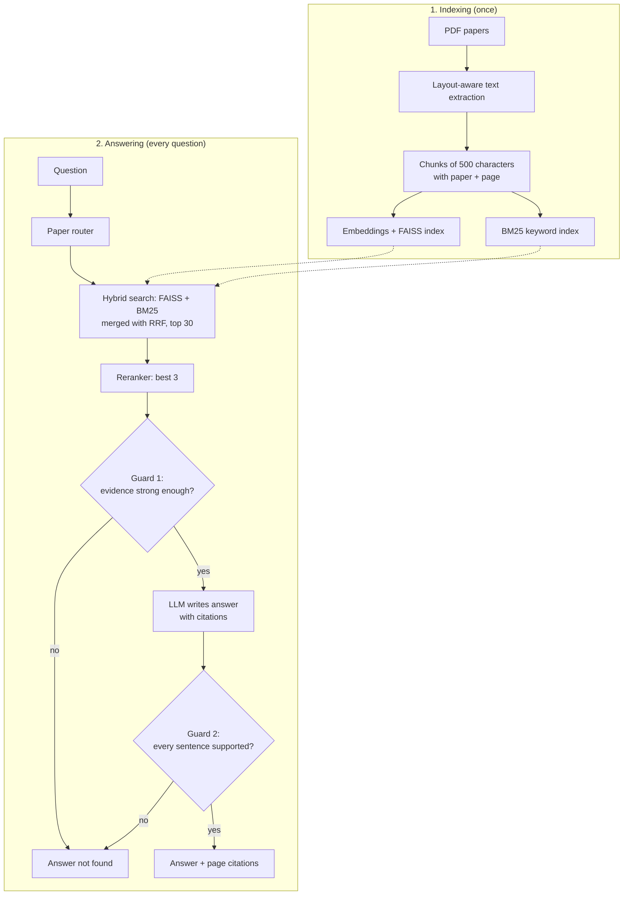

# MultiRAG

**Ask questions about research papers. Get answers with the exact paper and page they came from.**

MultiRAG is a Retrieval-Augmented Generation (RAG) system that runs fully on your own computer. It finds the relevant text in a set of PDF papers, lets a local LLM write an answer from that text only, and checks the answer before showing it. If the papers don't contain the answer, it says so instead of guessing.

```text
Ask: Which retriever do both RAG and Fusion-in-Decoder build on?
Answer: RAG and Fusion-in-Decoder both build on DPR's retriever [fid_izacard2021.pdf, p.3].

Ask: Who won the 2022 FIFA World Cup?
Answer: Answer not found in the papers.      (refused in under 1 second)
```

---

## Features

- **Questions across many papers** – ask about one paper or compare several.
- **Page-level citations** – every answer points to `[file.pdf, p.N]`.
- **Hybrid search** – meaning-based search (FAISS) plus exact-word search (BM25).
- **Reranker** – a second model re-sorts the results so the best evidence reaches the LLM.
- **Paper routing** – "Compare REALM and RAG" searches inside both papers.
- **Hallucination guard** – refuses when the evidence is weak and removes answer sentences the papers don't support.
- **Built-in evaluation** – 38 labelled test questions; every change was measured.
- **Fully local** – no API keys. Ollama runs the LLM; all models run on CPU.

---

## Results

Tested on 38 hand-written questions over 5 papers: 29 about one paper, 4 comparing papers, and 5 that the papers can't answer (the right response is to refuse).

- **Basic RAG** = the starting version: plain PDF text, meaning-based search only, no reranker, no guard.
- **MultiRAG** = the final version with all improvements.

| Metric | Basic RAG (starting version) | MultiRAG (final) |
|---|---|---|
| Correct page ranked first | 33% | **52%** |
| Correct page in the top 3 (what the LLM reads) | 70% | **82%** |
| Comparison questions: every named paper found | 79% | **100%** |
| Fully correct answers | 36% | **55%** |
| Answers citing the correct page | 52% | **62%** |
| Made-up answers to unanswerable questions (lower is better) | 40% | **20%** |

The hallucination guard removed **0 correct answers**, blocked **6 wrong answers** (invented numbers or model names), and blocked **2 made-up answers** to unanswerable questions.

<details>
<summary>What each improvement added (retrieval)</summary>

| Setup | Hit@1 | Hit@3 | MRR |
|---|---|---|---|
| Baseline: plain PDF text, meaning search only | 0.333 | 0.697 | 0.509 |
| + layout-aware PDF reading | 0.333 | 0.727 | 0.523 |
| + reranker | 0.545 | 0.758 | 0.665 |
| + BM25 hybrid search (no reranker) | 0.485 | 0.758 | 0.647 |
| + hybrid search **and** reranker | 0.576 | 0.788 | 0.678 |
| + paper routing (final) | 0.515 | 0.818 | 0.662 |

Hit@k = how often the correct page is in the top k results. MRR = average of 1 / (rank of the first correct result). Paragraph-based chunking was also tested and gave no gain, so the simpler fixed-size chunking is used.

</details>

---

## How it works



1. **Reading PDFs** – research papers have two columns. `pymupdf4llm` reads them in the right order and keeps tables intact, so numbers aren't scrambled.
2. **Chunking** – each page is cut into 500-character pieces that remember their paper and page number.
3. **Hybrid search** – FAISS finds chunks with similar *meaning*; BM25 finds chunks with the same *exact words* (names, numbers). Reciprocal Rank Fusion merges both lists.
4. **Reranking** – a cross-encoder reads the question and each of the top 30 chunks together and picks the best 3.
5. **Paper routing** – if the question names papers, it searches inside each one, so comparisons always see every paper.
6. **Answer writing** – phi3 (via Ollama) answers using only the 3 chunks and cites them as [1], [2], [3]; these are turned into `[file.pdf, p.N]`.
7. **Hallucination guard** –
   - *before the LLM:* if even the best chunk matches poorly (reranker score below -2.0), refuse straight away;
   - *after the LLM:* every sentence's key words and every number must appear in the evidence, otherwise the sentence is removed.

---

## Quick start

**Requirements:** Python 3.11 and [Ollama](https://ollama.com).

```bash
# 1. Get the code
git clone https://github.com/uday2319/Multi_RAG.git
cd Multi_RAG

# 2. Install
conda create -n rag_env python=3.11 -y
conda activate rag_env
pip install -r requirements.txt

# 3. Download the LLM
ollama pull phi3

# 4. Build the search index (about 1 minute)
python build_index.py
```

The embedding model and reranker (about 100 MB) download automatically on first run.

## Evaluation

```bash
# Full test: search + LLM + guard (about 12 minutes on CPU)
python eval/run_eval.py --label my_run

# Search only, no LLM (about 1 minute)
python eval/run_eval.py --label my_run --retrieval-only

# Compare setups
python eval/run_eval.py --label dense --retrieval-only --mode dense --no-rerank
python eval/run_eval.py --label no_routing --retrieval-only --routing off
``` 

## Configuration

All settings are in [`configure.py`](configure.py).

| Setting | Default | What it does |
|---|---|---|
| `RETRIEVAL_MODE` | `"hybrid"` | `"dense"` (meaning only) or `"hybrid"` (meaning + words) |
| `RERANKER_MODEL` | `ms-marco-MiniLM-L-6-v2` | Set to `None` to turn the reranker off |
| `PAPER_ROUTING` | `"all"` | `"off"`, `"multi"` (2+ papers named) or `"all"` |
| `TOP_K` | `3` | How many chunks the LLM reads |
| `LLM_MODEL` | `"phi3"` | Any model installed in Ollama |
| `GUARD_ENABLED` | `True` | Turn the hallucination guard on or off |
| `GUARD_MIN_RERANK_SCORE` | `-2.0` | Below this, refuse without calling the LLM |
| `CHUNK_SIZE` | `500` | Characters per chunk (re-run `build_index.py` after changing) |

---

## Project structure

```text
Multi_RAG/
├── configure.py            # all settings
├── build_index.py          # PDFs -> chunks -> embeddings -> index
├── main.py                 # the full pipeline + terminal chat
├── my_api.py               # FastAPI web service (POST /ask)
├── ingestion/
│   ├── pdf_processor.py    # PDF reading and chunking
│   └── figure_processor.py # figure image extraction
├── embeddings/
│   └── embedder.py         # sentence-transformers model
├── vectorestore/
│   └── faiss_store.py      # FAISS index: save, load, search
├── retrival/
│   ├── retreiver.py        # hybrid search, fusion, reranker
│   └── paper_router.py     # finds paper names in questions
├── LLM/
│   ├── generator.py        # prompt and Ollama call
│   └── guard.py            # hallucination guard
├── eval/
│   ├── golden_set.json     # 38 test questions
│   ├── run_eval.py         # evaluation script
│   └── results/            # saved test runs
├── data/papers/            # PDFs + papers.json
├── test_pdf.py             # quick check: PDF reading
└── test_figures.py         # quick check: figure extraction
```

**Papers included:**
[REALM](https://arxiv.org/abs/2002.08909) (2020),
[DPR](https://arxiv.org/abs/2004.04906) (2020),
[RAG](https://arxiv.org/abs/2005.11401) (2020),
[Fusion-in-Decoder](https://arxiv.org/abs/2007.01282) (2021),
[Self-RAG](https://arxiv.org/abs/2310.11511) (2023).

**Tech stack:** Python · PyMuPDF / pymupdf4llm · sentence-transformers · FAISS · rank-bm25 · cross-encoder reranker · Ollama (phi3) · FastAPI
---

The included papers belong to their authors and are used from arXiv for research and demonstration purposes.
