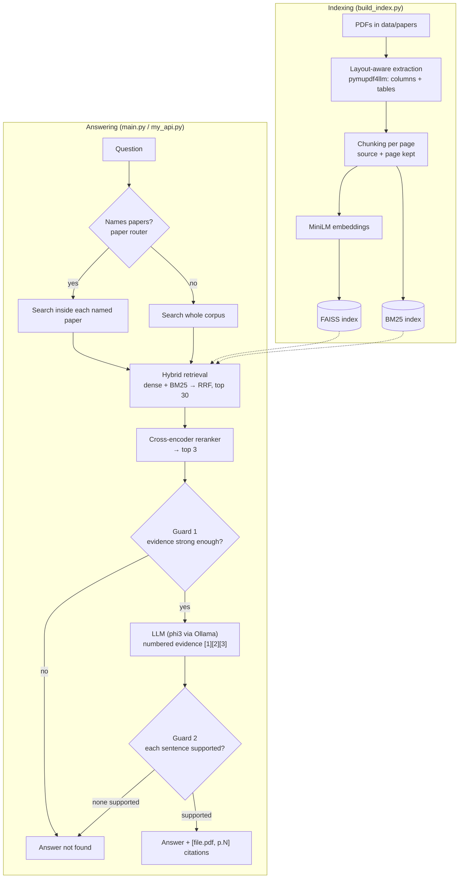

# 📚 MultiRAG — A Verifiable Research-Paper Assistant

Ask questions across multiple research papers and get answers **cited to the exact paper and page** — with a hallucination guard that refuses instead of guessing, and an evaluation harness that measures every design decision.

Runs fully locally: FAISS + BM25 retrieval, a cross-encoder reranker, and a local LLM via [Ollama](https://ollama.com).

```text
Ask: Which retriever do both RAG and Fusion-in-Decoder build on?

Answer: RAG and Fusion-in-Decoder both build on DPR's retriever [fid_izacard2021.pdf, p.3].

Ask: Who won the 2022 FIFA World Cup?

Answer: Answer not found in the papers.
[guard: weak_evidence]   ← refused in <1 s, the LLM was never called
```

---

## ✨ Highlights

| | |
|---|---|
| 📄 **Multi-paper Q&A** | Index any folder of PDFs; ask about one paper or compare several |
| 📍 **Page-level citations** | Every answer cites `[file.pdf, p.N]`; every chunk keeps its source and page |
| 🔎 **Hybrid retrieval** | Dense (FAISS) + keyword (BM25), merged with Reciprocal Rank Fusion |
| 🎯 **Cross-encoder reranking** | Re-scores candidates so the best evidence reaches the LLM |
| 🧭 **Paper-aware routing** | "Compare REALM and RAG" searches *inside each named paper* |
| 🛡️ **Hallucination guard** | Refuses on weak evidence; removes answer sentences whose words or numbers aren't in the evidence |
| 📊 **Evaluation harness** | 38 labelled questions; retrieval *and* answer metrics; every change measured |
| 🏠 **Fully local** | No API keys — Ollama for generation, Hugging Face models on CPU |

---

## 📈 Results

Measured on a hand-labelled set of **38 questions** over 5 papers (80 pages): 29 single-paper, 4 cross-paper, and 5 *unanswerable* questions where the correct behaviour is to refuse. Every gold answer is labelled with the page that supports it.

### Baseline → final system

| Metric | Baseline | Final | |
|---|---|---|---|
| Right page ranked **#1** (Hit@1) | 0.33 | **0.52** | ▲ |
| Right page in the **top 3** sent to the LLM (Hit@3) | 0.70 | **0.82** | ▲ |
| All named papers present in top 3 (cross-paper) | 0.79 | **1.00** | ▲ |
| **Fully correct answers** | 0.36 | **0.55** | ▲ +50% |
| Cross-paper answers correct | 0.25 | **0.50** | ▲ |
| Citations pointing to the gold page | 0.52 | **0.62** | ▲ |
| **Hallucinated answers on unanswerable questions** | 0.40 | **0.20** | ▼ halved |

> **Baseline:** plain PyMuPDF text, fixed 500-char chunks, dense-only top-3 retrieval, raw prompt to phi3.

### Ablation — what each component contributed (retrieval)

| Configuration | Hit@1 | Hit@3 | MRR |
|---|---|---|---|
| Baseline (plain text extraction, dense) | 0.333 | 0.697 | 0.509 |
| + layout-aware extraction | 0.333 | 0.727 | 0.523 |
| + cross-encoder reranker | 0.545 | 0.758 | 0.665 |
| + hybrid BM25 (no reranker) | 0.485 | 0.758 | 0.647 |
| + hybrid **and** reranker | **0.576** | 0.788 | **0.678** |
| + paper routing (final) | 0.515 | **0.818** | 0.662 |

Paper routing trades a little Hit@1 (it interleaves papers instead of trusting a single ranking) for **100 % cross-paper coverage**. Paragraph-based chunking was also tested and showed **no gain**, so it is off by default.

### Hallucination guard — effect on the same LLM answers

| | Count |
|---|---|
| Correct answers wrongly removed | **0** |
| Wrong answers (invented numbers / models) blocked | **6** |
| Hallucinations on unanswerable questions blocked | **2** |

Examples the guard caught: *"Paris"* (cited to a page that only contains the question *"What is the capital of France?"*), *"DPR achieves 84.5 %"* (paper says 78.4 %), *"FiD is initialized from BERT"* (it's T5).

---

## 🏗️ Architecture



### How each stage works

<details>
<summary><b>1. Layout-aware PDF extraction</b></summary>

Research papers are two-column. Naive extraction reads straight across the page and interleaves both columns, which garbles tables — the baseline LLM reported *"75.0 / 55.0"* for a table that says *78.4 / 59.1*. [`pymupdf4llm`](https://pypi.org/project/pymupdf4llm/) reads columns in order and converts tables to markdown, so numbers stay in their rows. Text drawn inside figures is dropped. See [`ingestion/pdf_processor.py`](ingestion/pdf_processor.py).
</details>

<details>
<summary><b>2. Hybrid retrieval with Reciprocal Rank Fusion</b></summary>

Dense embeddings capture *meaning* but are weak on exact terms like `RAG-Token`, `FAISS` or `ISREL`. BM25 matches *exact words*. Each returns its top 30; Reciprocal Rank Fusion scores each chunk as `Σ 1 / (60 + rank)` across both lists, so chunks both retrievers agree on rise to the top. See [`retrival/retreiver.py`](retrival/retreiver.py).
</details>

<details>
<summary><b>3. Cross-encoder reranking</b></summary>

The first stage compares separately-computed vectors — fast but approximate. The reranker ([`cross-encoder/ms-marco-MiniLM-L-6-v2`](https://huggingface.co/cross-encoder/ms-marco-MiniLM-L-6-v2)) reads the question and each candidate **together** and re-scores all 30. Retrieval gives recall; reranking gives precision. On CPU it adds well under a second.
</details>

<details>
<summary><b>4. Paper-aware routing</b></summary>

For *"How do RAG and Fusion-in-Decoder differ?"*, plain top-3 retrieval often returns three chunks from one paper. The router detects paper names using aliases in [`data/papers/papers.json`](data/papers/papers.json) (longest alias first, so *Self-RAG* is not mistaken for *RAG*), searches inside each named paper, and interleaves the results. See [`retrival/paper_router.py`](retrival/paper_router.py).
</details>

<details>
<summary><b>5. Grounded generation</b></summary>

Evidence is passed as numbered passages `[1] [2] [3]` via the Ollama chat API with a system prompt. Small models copy a short number far more reliably than a file name; the numbers are mapped back to `[file.pdf, p.N]` afterwards. Stop sequences prevent the model from inventing a follow-up prompt. See [`LLM/generator.py`](LLM/generator.py).
</details>

<details>
<summary><b>6. Two-step hallucination guard</b></summary>

- **Evidence gate (before the LLM):** if the best reranker score is below `-2.0`, refuse immediately. Answerable questions in the eval set scored ≥ −0.83; off-topic ones ≤ −2.84.
- **Answer check (after the LLM):** each answer sentence is checked against the retrieved evidence. The words it adds *beyond the question* must mostly appear in the evidence, and **every number** must appear verbatim. Unsupported sentences are removed; if none remain, the answer becomes a refusal.

See [`LLM/guard.py`](LLM/guard.py).
</details>

---

## 🚀 Quick start

### Prerequisites
- Python 3.11
- [Ollama](https://ollama.com) with a model pulled: `ollama pull phi3`

### Install

```bash
git clone https://github.com/uday2319/Multi_RAG.git
cd Multi_RAG

conda create -n rag_env python=3.11 -y
conda activate rag_env
pip install -r requirements.txt
```

### Build the index

```bash
python build_index.py
```

```text
dpr_karpukhin2020.pdf: 134 chunks
fid_izacard2021.pdf: 53 chunks
rag_lewis2020.pdf: 164 chunks
realm_guu2020.pdf: 115 chunks
selfrag_asai2023.pdf: 255 chunks
Total chunks: 721
Vector store created successfully.
```

The embedding model and reranker (~100 MB) download from Hugging Face on first run.

### Ask questions

**Command line**
```bash
python main.py
```

**REST API**
```bash
uvicorn my_api:app --reload
```
Open **http://127.0.0.1:8000/docs** for the interactive UI, or:

```bash
curl -X POST http://127.0.0.1:8000/ask \
     -H "Content-Type: application/json" \
     -d '{"question": "Who won the 2022 FIFA World Cup?"}'
```

```json
{
  "question": "Who won the 2022 FIFA World Cup?",
  "answer": "Answer not found in the papers.",
  "sources": [
    {"source": "selfrag_asai2023.pdf", "page": 24, "score": -4.522},
    {"source": "selfrag_asai2023.pdf", "page": 24, "score": -4.7724},
    {"source": "selfrag_asai2023.pdf", "page": 14, "score": -5.237}
  ],
  "guard": {"refused": true, "reason": "weak_evidence", "best_rerank_score": -4.52},
  "latency_seconds": 0.96
}
```

`score` is the reranker score of each source; `guard.reason` is `ok`, `removed_sentences`, `unsupported_answer`, `model_refused` or `weak_evidence`.

### Use your own papers
1. Drop PDFs into `data/papers/`.
2. *(Optional)* add their names and nicknames to `data/papers/papers.json` to enable paper routing.
3. Re-run `python build_index.py`.

---

## 📊 Evaluation

```bash
# Full run: retrieval + LLM + guard (~12 min with phi3 on CPU)
python eval/run_eval.py --label my_run

# Retrieval only (~1 min)
python eval/run_eval.py --label my_run --retrieval-only

# Ablations
python eval/run_eval.py --label dense  --retrieval-only --mode dense --no-rerank
python eval/run_eval.py --label hybrid --retrieval-only --mode hybrid --no-rerank
python eval/run_eval.py --label nort   --retrieval-only --routing off

# Re-score saved answers without calling the LLM again
python eval/run_eval.py --rescore eval/results/<file>.json   # after editing golden_set.json
python eval/run_eval.py --reguard eval/results/<file>.json   # after changing the guard
```

**Metrics**

| Retrieval | Answers |
|---|---|
| `hit@k` — a gold (paper, page) is in the top k | `answer_correct` — all required facts present |
| `mrr` — 1 / rank of the first gold page | `citation_gold` — citations pointing to a gold page |
| `cross_paper_cov@k` — share of named papers in top k | `hallucination_rate_unanswerable` — answered when it should refuse |
| | `false_refusal_rate` — refused an answerable question |

Each run scores the **raw LLM answer and the guarded answer from the same generation**, so the guard's effect is isolated. All runs are saved to [`eval/results/`](eval/results/) and the questions live in [`eval/golden_set.json`](eval/golden_set.json).

---

## ⚙️ Configuration

Everything is in [`configure.py`](configure.py):

| Setting | Default | Description |
|---|---|---|
| `PDF_EXTRACTOR` | `"markdown"` | `"markdown"` (layout-aware) or `"text"` (plain) |
| `CHUNKING` / `CHUNK_SIZE` | `"fixed"` / `500` | `"fixed"` or `"paragraph"` chunking |
| `RETRIEVAL_MODE` | `"hybrid"` | `"dense"` or `"hybrid"` (dense + BM25) |
| `CANDIDATES` | `30` | Candidates per retriever before fusion / reranking |
| `RERANKER_MODEL` | `ms-marco-MiniLM-L-6-v2` | `None` disables reranking |
| `PAPER_ROUTING` | `"all"` | `"off"`, `"multi"` (2+ papers named) or `"all"` |
| `TOP_K` | `3` | Chunks given to the LLM |
| `LLM_MODEL` | `"phi3"` | Any Ollama model |
| `GUARD_ENABLED` | `True` | Turn the hallucination guard on / off |
| `GUARD_MIN_RERANK_SCORE` | `-2.0` | Evidence-gate threshold |
| `GUARD_MIN_SUPPORT` | `0.5` | Share of a sentence's new words that must be in the evidence |

Re-run `build_index.py` after changing PDFs, `PDF_EXTRACTOR` or chunking settings.

---

## 📁 Project structure

```text
Multi_RAG/
├── configure.py              # all settings
├── build_index.py            # PDFs → chunks → embeddings → FAISS
├── main.py                   # create_rag(), answer_question(), CLI
├── my_api.py                 # FastAPI service (POST /ask)
├── ingestion/
│   ├── pdf_processor.py      # layout-aware extraction + chunking
│   └── figure_processor.py   # figure image extraction
├── embeddings/embedder.py    # sentence-transformers wrapper
├── vectorestore/faiss_store.py
├── retrival/
│   ├── retreiver.py          # hybrid search, RRF, reranker, routing
│   └── paper_router.py       # detects paper names in questions
├── LLM/
│   ├── generator.py          # prompt, Ollama call, citation mapping
│   └── guard.py              # hallucination guard
├── eval/
│   ├── golden_set.json       # 38 labelled questions
│   ├── run_eval.py           # metrics, ablations, rescore / reguard
│   └── results/              # every evaluation run
└── data/
    ├── papers/               # PDFs + papers.json catalog
    └── figures/
```

### Included papers

| Paper | Year |
|---|---|
| [REALM: Retrieval-Augmented Language Model Pre-Training](https://arxiv.org/abs/2002.08909) | 2020 |
| [Dense Passage Retrieval for Open-Domain Question Answering](https://arxiv.org/abs/2004.04906) | 2020 |
| [Retrieval-Augmented Generation for Knowledge-Intensive NLP Tasks](https://arxiv.org/abs/2005.11401) | 2020 |
| [Leveraging Passage Retrieval with Generative Models (Fusion-in-Decoder)](https://arxiv.org/abs/2007.01282) | 2021 |
| [Self-RAG: Learning to Retrieve, Generate, and Critique](https://arxiv.org/abs/2310.11511) | 2023 |

Five generations of retrieval-augmented models — so cross-paper questions have real answers.

---

## 🧪 Tech stack

**Retrieval:** FAISS · sentence-transformers (`all-MiniLM-L6-v2`) · rank-bm25 · cross-encoder reranker
**Ingestion:** PyMuPDF · pymupdf4llm
**Generation:** Ollama (phi3, swappable)
**Serving:** FastAPI · Uvicorn

---

## ⚠️ Limitations

Reported honestly, because they point to the next steps:

- **The small LLM is the main bottleneck.** In about 10 questions, the right page was retrieved but phi3 still answered wrongly.
- **The guard checks words, not meaning.** *"GPT-4 needs 24GB"* passes because "24GB" is in the evidence — it's actually Self-RAG's GPU memory. Catching misattributed facts needs an NLI (entailment) model.
- **Small, single-split evaluation.** The guard threshold was chosen on the same 38 questions it is scored on, and only 5 are unanswerable — the rates are indicative, not precise.
- **Routing assumes the named paper holds the answer.** A question that names one paper but is answered in another will be routed to the wrong place.

## 🗺️ Roadmap

- [ ] NLI-based sentence verification to catch misattributed facts
- [ ] Larger held-out evaluation set (incl. more unanswerable and cross-paper questions)
- [ ] Benchmark stronger local LLMs (Llama 3.1, Qwen 2.5) against phi3
- [ ] Figure and table retrieval — return the figure image with the answer
- [ ] Web UI that opens the PDF at the cited page
- [ ] Docker image

---

## 🙏 Acknowledgements

The indexed papers belong to their authors and are included from arXiv for research and demonstration purposes.
